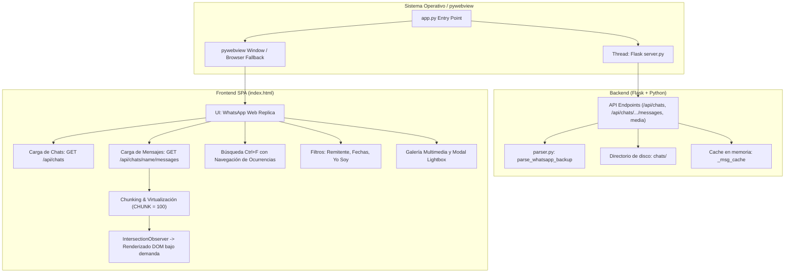

# Base de Arquitectura y Referencia Técnica — WhatsApp Backup Viewer

Este documento sirve como guía y referencia técnica integral del proyecto **WhatsApp Backup Viewer** (desarrollado originalmente por DMDevLabs con asistencia de Claude). Detalla el estado actual, diseño del sistema, estructura de datos, componentes y consideraciones críticas para realizar cambios estructurales o nuevas funcionalidades.

---

## 1. Visión General del Proyecto

- **Propósito:** Visualizador de copias de seguridad de WhatsApp exportadas (.txt y archivos multimedia adjuntos).
- **Entorno:** Aplicación de escritorio portable 100% local y offline (sin telemetría ni dependencias de internet).
- **Licencia:** GNU General Public License v3.0 (GPLv3).
- **Pila Tecnológica:**
  - **Backend:** Python 3.10+, Flask
  - **Parser:** Python puro (Regex, normalización Unicode, Dataclasses)
  - **Frontend:** SPA nativa (HTML5 / CSS3 / JavaScript vanilla sin dependencias externas)
  - **GUI Desktop:** `pywebview` (con fallback automático a navegador web mediante `webbrowser`)
  - **Empaquetado:** PyInstaller (`.spec` y script `build.bat`) con firma de código PowerShell

---

## 2. Estructura de Archivos y Responsabilidades

```
ProyectoWhatsapp/
│
├── app.py                     # Entry point principal. Inicia Flask en hilo daemon y levanta ventana pywebview / navegador.
├── server.py                  # API REST Flask y servidor de archivos estáticos / multimedia.
├── parser.py                  # Motor de extracción y parseo de logs de texto de WhatsApp (.txt).
├── storage.py                 # Módulo de persistencia local (favoritos en favorites.json).
│
├── templates/
│   └── index.html             # Frontend SPA completo (CSS embebido + HTML + JS).
│
├── chats/                     # Directorio de datos (subcarpetas con chats exportados y sus adjuntos).
│   └── <NombreChat>/
│       ├── Chat de WhatsApp con <NombreChat>.txt
│       ├── IMG-*.jpg, VID-*.mp4, AUD-*.opus, *.pdf, etc.
│
├── test_parser.py             # Pruebas unitarias para el parser.
├── sample_whatsapp_backup.txt # Archivo de ejemplo para pruebas rápidas.
├── requirements.txt           # Dependencias Python mínimas (flask, pywebview).
│
├── WhatsApp Viewer.spec       # Configuración PyInstaller con exclusiones y bundles.
├── build.bat                  # Script de compilación, empaquetado y firma digital.
├── create_cert.ps1            # Generación de certificado autofirmado para el .exe.
├── gen_icon.py                # Generador de iconos (.ico y .png).
├── version_info.py / .txt     # Metadatos del ejecutable Windows (versión, autor, copyright).
└── README.md                  # Documentación de cara al usuario.
```

---

## 3. Arquitectura del Sistema y Flujo de Datos



---

## 4. Detalle de Componentes

### 4.1. Entry Point (`app.py`)
- Detecta si está congelado con PyInstaller mediante `getattr(sys, "frozen", False)`.
  - Si es ejecutable: `_BASE = dirname(sys.executable)`, `_BUNDLE = sys._MEIPASS`.
  - Si es desarrollo: `_BASE = _BUNDLE = dirname(abspath(__file__))`.
  - Exporta variables de entorno `APP_BASE` y `APP_BUNDLE` usadas por `server.py` y `storage.py`.
- Lanza Flask en `127.0.0.1:5000` dentro de un hilo en segundo plano (`daemon=True`).
- Intenta abrir `webview.create_window` (1200x800, min 800x500). Si no está disponible, hace fallback silencioso a `webbrowser.open()`.

### 4.2. Servidor Backend (`server.py`)
- **Cabeceras:** Aplica `Cache-Control: no-store` en todas las respuestas para evitar estancamiento de datos.
- **Límite de subida:** `MAX_CONTENT_LENGTH = 200MB`.
- **Rutas principales:**
  - `GET /`: Renderiza `templates/index.html`.
  - `GET /api/chats`: Escanea `chats/`, localiza carpetas que tengan al menos un `.txt`, y cuenta archivos que coincidan con `_MEDIA_EXTS`.
  - `GET /api/chats/<name>/messages`:
    - Revisa `_msg_cache[name]`.
    - Si no está en caché, lee el primer `.txt` con codificación `utf-8` (fallback `errors="replace"`).
    - Ejecuta `parse_whatsapp_backup()`.
    - Detecta existencia física de adjuntos en disco (`existing = {f.name for f in folder.iterdir()}`).
    - Identifica remitentes únicos y determina quién es el usuario actual (`myName = 'Tú'` o `'You'` o el primer remitente).
    - Retorna objeto JSON con lista de mensajes serializados y metadatos.
  - `GET /api/chats/<name>/media/<path:filename>`:
    - Validación de seguridad: Verifica que la ruta resuelta pertenezca a la subcarpeta del chat mediante `is_relative_to(folder.resolve())` (prevención de Path Traversal).
    - Sirve el archivo con `send_file()`. Soporta `.opus` configurado como `audio/ogg`.

### 4.3. Motor de Parseo (`parser.py`)
- **Dataclass `ChatMessage`:**
  - `date`: Cadena de fecha (ej. `12/10/2024`, `10/14/24`).
  - `time`: Cadena de hora (ej. `20:15`, `8:18 a. m.`, `9:30 PM`, `9:30:15 PM`).
  - `sender`: Nombre del emisor o `"Sistema"`.
  - `text`: Texto del mensaje.
  - `raw`: Línea original.
  - `media_type`: `'image'`, `'video'`, `'audio'`, `'sticker'`, `'document'`, `'omitted'` o `None`.
  - `media_file`: Nombre del archivo adjunto (ej. `IMG-20210828-WA0012.jpg`) o `None`.
  - Propiedad `datetime_obj`: Conversión a objeto `datetime` con soporte para formatos de 12h (AM/PM) y 24h, años de 2 y 4 dígitos, y segundos opcionales.
- **Normalización de Texto:**
  - Limpieza exhaustiva de marcas Unicode invisibles (`\u200e`, `\u200f`, `\u202a`..`\u202e`, `\u2066`..`\u2069`, `\ufeff`, `\u200b`, `\xa0`, `\u202f`, `\u2007`).
- **Expresiones Regulares Universales:**
  - `MESSAGE_PATTERN_STANDARD`: Soporta Android y Web en español e inglés (fechas con `/`, `-`, `.`, horas 12h/24h con AM/PM o a. m./p. m.).
  - `MESSAGE_PATTERN_IOS`: Soporta formato entre corchetes de iOS (`[date, time] Sender: Message` o `[date, time] System`).
- **Soporte Multilínea:** Concatena líneas continuas preservando saltos de línea.
- **Detección de Multimedia:**
  - `_MEDIA_ATTACH_PATTERNS`: Soportan `(archivo adjunto)`, `(file attached)`, `<attached: filename>` y `<adjunto: filename>`.
  - `_MEDIA_OMITTED`: `<multimedia omitido>`, `<media omitted>`, etc.
- **Filtrado y Agrupamiento:** `filter_messages` (admite `"Todos"` o `"All"`, texto y fechas normalizadas) y `group_messages_by_sender`.

### 4.4. Frontend SPA (`templates/index.html`)
- **Sistema de Internacionalización (i18n ES/EN):**
  - Diccionario estructurado `I18N = { es: {...}, en: {...} }` con soporte 100% de traducción.
  - Selector de idioma en el header (`#lang-btn`) con persistencia en `localStorage['wbv-lang']`.
  - Modales completos de Términos y Condiciones y Manual de Usuario disponibles en ambos idiomas sin recargar la página.
- **CSS y Diseño:**
  - Inspirado en WhatsApp Web (fondo con patrón svg tenue, burbujas verdes a la derecha para mensajes enviados y oscuras/blancas a la izquierda para recibidos).
  - Variables CSS para Modo Claro (`[data-theme="light"]`) y Modo Oscuro (por defecto). Persistencia en `localStorage['wbv-theme']`.
- **Rendimiento y Virtualización de Mensajes:**
  - Parámetro `CHUNK = 100`: Divide los mensajes en bloques de 100.
  - Solo los últimos 3 bloques se renderizan inmediatamente al cargar.
  - Los bloques restantes se crean como contenedores con altura estimada y `content-visibility: auto`.
  - Un `IntersectionObserver` renderiza el HTML del chunk conforme el usuario hace scroll (`renderChunkAt`).
  - Capacidad probada para manejar chats masivos de **30,000+ mensajes** sin congelar el navegador.
- **Búsqueda Avanzada (Ctrl+F):**
  - Construye un índice en minúsculas en memoria (`S.searchIdx`).
  - Busca coincidencias en tiempo real con debounce de 300ms.
  - Permite navegar coincidencias con `Enter` / `Shift+Enter` o botones anterior/siguiente.
  - Si una coincidencia está en un bloque no renderizado, fuerza el renderizado del chunk antes de posicionar y aplicar scroll con `scrollIntoView`.
  - Resaltado visual con `<mark class="hl">` y `<mark class="hl cur">`.
- **Filtros Dinámicos:**
  - Filtro por remitente (`#f-sender`).
  - Selector "Yo soy" (`#f-me`): Permite cambiar la perspectiva del usuario para que sus propios mensajes aparezcan a la derecha en verde.
  - Rango de fechas inicio / fin.
- **Galería Multimedia:**
  - Panel deslizante con pestañas: Fotos, Videos, Stickers, Documentos, Audios.
  - Vista en cuadrícula o lista interactiva.
- **Lightbox:**
  - Visualizador modal a pantalla completa para imágenes y videos (soporte para cerrar con tecla `Escape` o clic fuera).
- **Modales de Información:**
  - Términos y Condiciones (con confirmación almacenada en `localStorage`).
  - Manual de Usuario interactivo con pestañas de instrucciones para exportar chats en Android y iPhone.

### 4.5. Persistencia y Almacenamiento (`storage.py`)
- Manejo de favoritos mediante `favorites.json`.
- Funciones: `load_favorites()`, `save_favorites()`, `save_favorite_conversation()`.
- *Nota:* Actualmente el frontend y los endpoints de `server.py` no tienen enlazada la funcionalidad de favoritos, pero la lógica de backend en `storage.py` ya está creada.

### 4.6. Compilación y Empaquetado (`WhatsApp Viewer.spec` / `build.bat`)
- PyInstaller genera un binario único (`dist/WhatsApp Viewer.exe`).
- Excluye librerías innecesarias de gran tamaño (`numpy`, `pandas`, `matplotlib`, `PyQt5`, `tkinter`, etc.) para reducir el tamaño del ejecutable.
- Incorpora las plantillas (`templates/`), iconos (`app.ico`, `app_icon_256.png`) y dependencias nativas de `webview`.
- `build.bat` incluye un paso para firmar el ejecutable usando PowerShell y certificados locales si existen.

---

## 5. Puntos Críticos y Reglas para Cambios Grandes

1. **Mantener la naturaleza 100% Offline:**
   - No usar CDNs externas (Google Fonts, FontAwesome CDN, Tailwind CDN, etc.). Todo recurso debe ser local o generado con CSS/SVG nativo.
2. **Preservar el rendimiento en Chats Grandes:**
   - Cualquier modificación en la vista de mensajes o inserción de nuevos elementos en el DOM debe integrarse con el sistema de **chunks/virtualización** (`CHUNK = 100` y `IntersectionObserver`).
3. **Robustez en la Variación de Formatos de WhatsApp:**
   - WhatsApp cambia el formato de fecha/hora según el idioma del teléfono (12h con "a. m."/"p. m.", 24h, DD/MM/AAAA vs MM/DD/AAAA).
   - Siempre preservar la normalización Unicode (`\u00a0`, caracteres LTR/RTL invisibles como `\u200e`).
4. **Compatibilidad con PyInstaller:**
   - El acceso a rutas relativas debe mantener siempre la lógica `APP_BASE` (para archivos del usuario como `chats/` o `favorites.json`) y `APP_BUNDLE` (para recursos empaquetados como `templates/` o imágenes estáticas).
5. **Seguridad Local:**
   - Toda lectura o servicio de archivos multimedia debe validar `is_relative_to` para evitar vulnerabilidades de directory traversal.

---
*Documento de referencia base generado para guiar refactorizaciones, extensiones y cambios mayores en el proyecto.*

